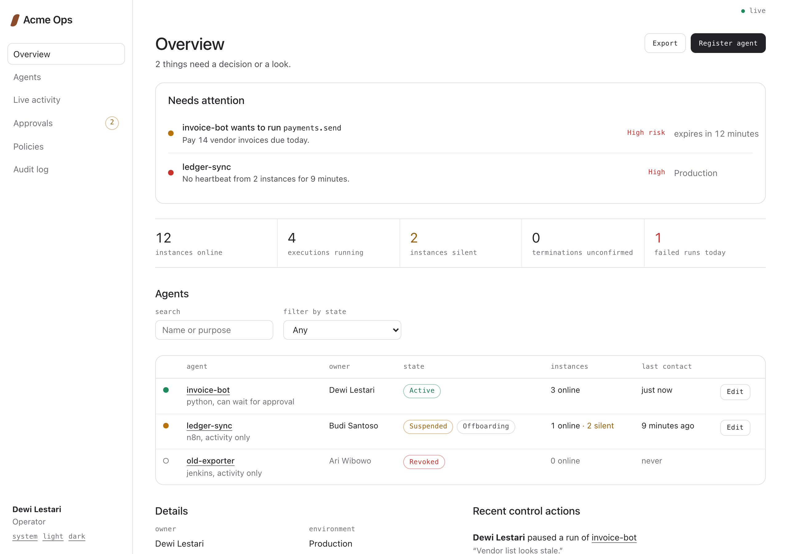
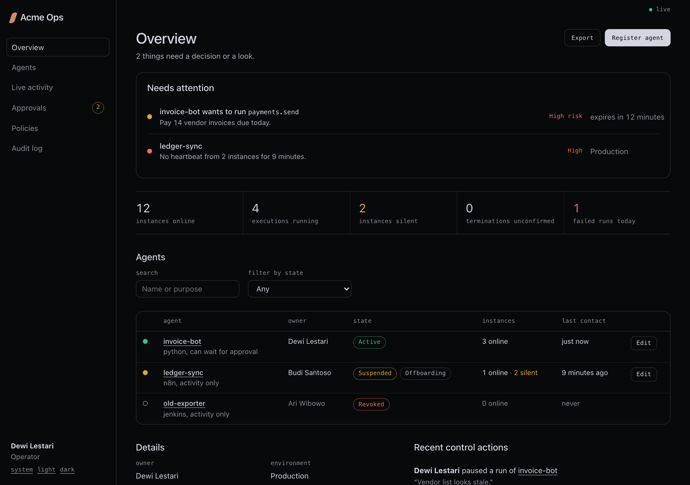

# console-line-ui

An agent skill for a quiet, exact interface style built for operational consoles: fleets, queues, approvals, audit logs, kill switches.

**Colour is information, structure is a hairline, emphasis is ink. Nothing is decoration.**

| Light | Dark |
|---|---|
|  |  |

## Install

```bash
npx skills add fahmifashaa/console-line-ui
```

Works with Claude Code, Codex, Cursor, Copilot CLI, Gemini CLI and other agents the `skills` CLI supports. Add `-g` to install for every project.

Then ask your agent for anything "in the console-line-ui style", or run `/console-line-ui`.

## What the agent gets

- **Seven laws.** One ink on one ground. Colour only for signals (ok, warn, danger). 1px structure, no shadows or gradients. Lower-case monospace labels. Two radii. Quiet 32px controls with one primary per view. Calm motion and plain words.
- **Tokens** for light and dark with measured WCAG contrast (signal text passes AA), plus Tailwind and CSS-in-JS mappings.
- **A component catalogue:** shell and rail, page header, attention panel, tallies (instead of stat cards), tables, facts, badges, lamps, buttons, three tiers of destructive actions, the kill switch, forms, options, dialogs, tabs, queue/detail split, timeline, charts, empty and loading states.
- **Voice rules** for ledes, empty states, buttons, hints and confirmations.
- **Boundaries:** 20 hard rules with in-style alternatives, cases allowed with a reason, and how to extend without drifting.
- **Assets:** a framework-free `console-line.css`, React primitives in `ui.tsx`, and `specimen.html`.
- **A linter** that catches drift: `node skills/console-line-ui/scripts/check-style.mjs src/`

## Use the CSS without an agent

Copy `skills/console-line-ui/assets/console-line.css` into a project and open `specimen.html` next to it to see every component. To brand it, replace `--brand` (it is used only in the wordmark mark) and keep everything else ink.

## Credits

Isometric line illustrations follow the Hairline figures by Lucas Marques ([lucasmarkes/hairline](https://github.com/lucasmarkes/hairline), MIT). This skill doesn't bundle the Hairline kernel; it points to it.

## License

MIT
